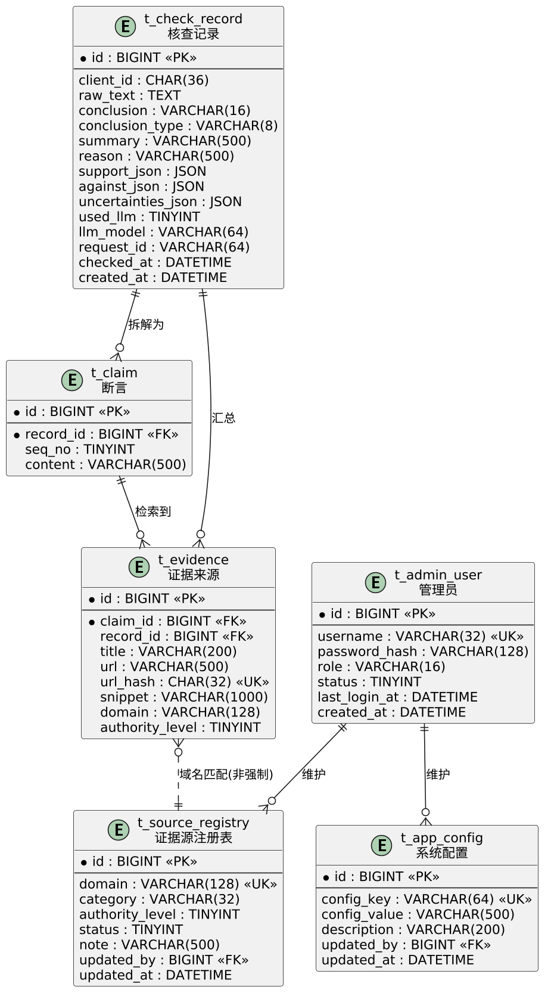

<!-- title: FactLens 事实透镜 -->
<!-- subtitle: AI 多领域虚假信息鉴别智能体 -->
<!-- doctype: 数据库设计说明书 -->
<!-- doctype_en: Database Design Specification -->
<!-- version: V1.0 -->
<!-- date: 2026-11-22 -->
<!-- team: FactLens -->
<!-- course: 广东工业大学计算机学院 · 计科 24 级 56 班 · 软件工程 -->
<!-- teacher: flowet -->
<!-- members: 3224004156－刘心怡 | 3224004158－杨添媛 | 3224004157－吴纯瑶 | 3224004155－李晨昀 | 3124004111－依木拉木·阿不都苏力 | 3124004121－艾力夏提·艾海买提 | 3124004146－杨宗林 -->

# 1 引言

## 1.1 编写目的

本文档是 FactLens 事实透镜的数据库设计说明书，依据 GB/T 8567—2006《计算机软件文档编制规范》中数据库设计说明书的编制要求编写，对应第二次团队作业（原型设计 + 概要设计）的数据库设计部分。

首版系统将历史记录保存在浏览器本地，尚无服务端数据库。迭代二引入服务端数据库，实现核查记录持久化（需求 R01）、管理后台（R02）与证据源注册表（R03）。本文档给出该数据库的概念结构（ER 图）、逻辑结构（关系模式）、物理结构与对象关系映射，作为迭代二建库与编码的依据。

## 1.2 背景

| 项 | 内容 |
| --- | --- |
| 数据库名称 | factlens |
| 数据库系统 | 线上 MySQL 8.0（PythonAnywhere 托管提供）；本地开发 SQLite 3 |
| 访问方式 | Python 后端经 SQLAlchemy ORM 访问；管理后台经 /api/admin/* 接口间接访问 |
| 使用它的程序 | FactLens 后端核查服务（落库核查记录）、管理后台（运维与配置） |
| 首次建库时间 | 迭代二（计划 2026 年 11 月下旬） |

## 1.3 定义

本文档使用的缩写与术语与《FactLens 系统设计说明书》1.3 节一致，此处补充数据库专用术语：

| 术语 | 定义 |
| --- | --- |
| ER 模型 | Entity-Relationship 实体联系模型，用实体、属性、联系描述概念结构 |
| 关系模式 | 用二维表描述的数据库逻辑结构，本文档以 t_ 前缀命名六张表 |
| ORM | 对象关系映射，实体类与库表之间的映射关系，见附录 A |
| 权威等级 | 证据源可信度分档：3=高、2=中、1=低、0=黑名单 |
| 软删除 | 通过 status 字段标记停用而非物理删除，保证历史数据可追溯 |

## 1.4 参考资料

| 编号 | 资料 |
| --- | --- |
| [1] | 《FactLens 系统设计说明书》（本文档姊妹篇，第 5 章系统数据结构设计） |
| [2] | 团队仓库需求说明 docs/requirements.md（F01～F08） |
| [3] | GB/T 8567—2006 计算机软件文档编制规范 |
| [4] | 课程作业要求（第二次团队作业） |
| [5] | SQLAlchemy 2.0 文档、MySQL 8.0 参考手册 |

# 2 外部设计

## 2.1 标识符和状态

| 项 | 约定 |
| --- | --- |
| 数据库名 | factlens |
| 表名 | t_ 前缀 + 小写下划线（如 t_check_record），共 6 张 |
| 字段名 | 小写下划线（如 conclusion_type） |
| 主键 | 每表 BIGINT 自增 id（t_evidence 附加 url_hash 唯一键） |
| 外键 | 以 _id 结尾，指向主表主键 |
| 状态字段 | status / 软删除标记，1=正常启用，0=停用 |

## 2.2 使用它的程序

| 程序 | 访问表 | 操作 |
| --- | --- | --- |
| 后端核查服务（编排层/报告生成） | t_check_record、t_claim、t_evidence | INSERT（核查落库） |
| 降级判定引擎（RuleJudge） | t_source_registry | SELECT（权威域名加权） |
| 管理后台-概览 | t_check_record | SELECT（统计聚合） |
| 管理后台-记录管理 | t_check_record | SELECT / DELETE |
| 管理后台-证据源管理 | t_source_registry | CRUD |
| 管理后台-系统配置 | t_app_config | SELECT / UPDATE |
| 管理后台-登录 | t_admin_user | SELECT（口令校验）、UPDATE（登录时间） |

## 2.3 约定

1. **命名约定**：表/字段一律小写下划线；布尔字段以 tinyint(1) 表达；时间字段为 datetime 类型，存北京时间字符串（UTC+8），与首版 checked_at 格式一致；
2. **主外键约定**：主键 BIGINT 自增；外键同类型并建普通索引；外键关联仅作逻辑约束（应用层校验），不启用级联物理删除，删除记录采用应用层先删子表再删主表的事务顺序；
3. **JSON 字段约定**：support_json、against_json、uncertainties_json 存字符串数组的 JSON 文本，避免三张明细表；
4. **去重约定**：证据以 url_hash（URL 规范化后 MD5）唯一索引去重，与首版"按 URL 去重"行为一致；
5. **字符集约定**：utf8mb4 / utf8mb4_unicode_ci。

## 2.4 专门指导

- 建库脚本、表结构变更脚本随仓库版本管理（tools/schema 或 migrations 目录）；
- 迭代二上线前用真实核查流量做一次迁移演练：将 localStorage 历史导出为 JSON，批量写入 t_check_record；
- 敏感字段（管理员口令哈希、API 密钥）不得出现在日志、备份导出物与仓库中。

## 2.5 支持软件

| 软件 | 用途 |
| --- | --- |
| MySQL 8.0（线上）/ SQLite 3（本地） | 数据库系统 |
| SQLAlchemy 2.0（Python） | ORM 与连接管理 |
| pymysql（线上）/ 内置 sqlite3（本地） | 数据库驱动 |
| MySQL Workbench / DBeaver | 设计与管理工具 |

# 3 结构设计

## 3.1 概念结构设计（ER 图）



实体与联系说明：

| 实体 | 含义 | 主要联系 |
| --- | --- | --- |
| t_check_record 核查记录 | 一次核查的完整存档 | 拆解为 1～3 条断言；汇总多条证据 |
| t_claim 断言 | 从原文拆出的可独立查证陈述 | 属于 1 条记录；检索到 0～n 条证据 |
| t_evidence 证据来源 | 断言的一条检索来源 | 属于 1 条断言并冗余关联记录；与注册表按域名匹配（非强制） |
| t_source_registry 证据源注册表 | 域名可信度档案 | 由管理员维护；参与判定加权 |
| t_admin_user 管理员 | 后台账号 | 维护注册表与系统配置 |
| t_app_config 系统配置 | 键值配置 | 由管理员维护 |

设计要点：证据同时挂靠断言（claim_id）与记录（record_id），既支持"断言级证据展示"（R04），也便于按记录统计来源数；注册表与证据之间是**按域名的非强制匹配**——证据落库时记录当时的权威等级快照，注册表后续调整不影响历史报告。

## 3.2 逻辑结构设计（关系模式）

### 3.2.1 t_check_record 核查记录表

| 字段 | 类型 | 空 | 默认 | 说明 |
| --- | --- | --- | --- | --- |
| id | BIGINT | 否 | 自增 | 主键 PK |
| client_id | CHAR(36) | 是 | NULL | 匿名客户端标识（浏览器生成 UUID，迭代二用于跨设备同步） |
| raw_text | TEXT | 否 | | 待核查原文（≤2000 字） |
| conclusion | VARCHAR(16) | 否 | | 四值结论中文名 |
| conclusion_type | VARCHAR(8) | 否 | | true/false/partial/unknown |
| summary | VARCHAR(500) | 否 | | 整体分析摘要 |
| reason | VARCHAR(500) | 否 | | 判定理由 |
| support_json | JSON | 是 | NULL | 支持要点数组 |
| against_json | JSON | 是 | NULL | 反驳要点数组 |
| uncertainties_json | JSON | 是 | NULL | 不确定因素数组 |
| claim_count | TINYINT | 否 | 1 | 断言数（冗余，便于列表展示） |
| source_count | SMALLINT | 否 | 0 | 来源数（冗余，便于列表展示） |
| used_llm | TINYINT(1) | 否 | 0 | 是否模型判定 |
| llm_model | VARCHAR(64) | 是 | NULL | 本次判定所用模型名 |
| request_id | CHAR(32) | 是 | NULL | 请求编号，关联服务端日志（迭代二） |
| checked_at | DATETIME | 否 | | 核查时间（北京时间） |
| status | TINYINT | 否 | 1 | 1=正常，0=已删除（软删除） |
| created_at | DATETIME | 否 | 当前时间 | 落库时间 |

索引：PK(id)；IDX(checked_at)；IDX(conclusion_type)；IDX(client_id)。

### 3.2.2 t_claim 断言表

| 字段 | 类型 | 空 | 默认 | 说明 |
| --- | --- | --- | --- | --- |
| id | BIGINT | 否 | 自增 | 主键 PK |
| record_id | BIGINT | 否 | | 外键 FK → t_check_record.id |
| seq_no | TINYINT | 否 | 1 | 断言序号（1～3） |
| content | VARCHAR(500) | 否 | | 断言内容 |

索引：PK(id)；IDX(record_id)；UK(record_id, seq_no)。

### 3.2.3 t_evidence 证据来源表

| 字段 | 类型 | 空 | 默认 | 说明 |
| --- | --- | --- | --- | --- |
| id | BIGINT | 否 | 自增 | 主键 PK |
| claim_id | BIGINT | 否 | | 外键 FK → t_claim.id |
| record_id | BIGINT | 否 | | 冗余外键 FK → t_check_record.id |
| title | VARCHAR(200) | 否 | | 来源标题 |
| url | VARCHAR(500) | 否 | | 来源链接 |
| url_hash | CHAR(32) | 否 | | URL 规范化后 MD5，唯一键 UK |
| snippet | VARCHAR(1000) | 是 | NULL | 摘要 |
| domain | VARCHAR(128) | 否 | | 域名（www. 已剥除） |
| authority_level | TINYINT | 否 | 1 | 落库时权威等级快照（3/2/1/0） |
| created_at | DATETIME | 否 | 当前时间 | 落库时间 |

索引：PK(id)；UK(url_hash)；IDX(claim_id)；IDX(record_id)；IDX(domain)。

### 3.2.4 t_source_registry 证据源注册表

| 字段 | 类型 | 空 | 默认 | 说明 |
| --- | --- | --- | --- | --- |
| id | BIGINT | 否 | 自增 | 主键 PK |
| domain | VARCHAR(128) | 否 | | 域名，唯一键 UK |
| category | VARCHAR(32) | 否 | | 类别（官方政府/官方媒体/医疗机构/百科/专业媒体/社区/谣言站点等） |
| authority_level | TINYINT | 否 | 1 | 权威等级：3=高、2=中、1=低、0=黑名单 |
| status | TINYINT | 否 | 1 | 1=启用，0=停用 |
| note | VARCHAR(500) | 是 | NULL | 备注（登记理由等） |
| updated_by | BIGINT | 是 | NULL | 外键 FK → t_admin_user.id，最后维护人 |
| updated_at | DATETIME | 否 | 当前时间 | 更新时间 |

索引：PK(id)；UK(domain)；IDX(authority_level, status)。

### 3.2.5 t_admin_user 管理员表

| 字段 | 类型 | 空 | 默认 | 说明 |
| --- | --- | --- | --- | --- |
| id | BIGINT | 否 | 自增 | 主键 PK |
| username | VARCHAR(32) | 否 | | 登录名，唯一键 UK |
| password_hash | VARCHAR(128) | 否 | | 口令哈希（bcrypt），不存明文 |
| role | VARCHAR(16) | 否 | admin | 角色：admin=超级管理员，operator=运维员 |
| status | TINYINT | 否 | 1 | 1=启用，0=停用 |
| last_login_at | DATETIME | 是 | NULL | 最近登录时间 |
| created_at | DATETIME | 否 | 当前时间 | 创建时间 |

索引：PK(id)；UK(username)。

### 3.2.6 t_app_config 系统配置表

| 字段 | 类型 | 空 | 默认 | 说明 |
| --- | --- | --- | --- | --- |
| id | BIGINT | 否 | 自增 | 主键 PK |
| config_key | VARCHAR(64) | 否 | | 配置键，唯一键 UK（如 LLM_MODEL、SEARCH_RESULTS_PER_CLAIM） |
| config_value | VARCHAR(500) | 否 | | 配置值 |
| description | VARCHAR(200) | 是 | NULL | 用途说明 |
| updated_by | BIGINT | 是 | NULL | 外键 FK → t_admin_user.id |
| updated_at | DATETIME | 否 | 当前时间 | 更新时间 |

索引：PK(id)；UK(config_key)。

约定：t_app_config 只存非敏感配置；LLM_API_KEY 仍只保存在服务端 .env，不入库、不入仓库。应用启动时"环境变量优先，库表配置覆盖默认值"。

## 3.3 物理结构设计

1. **存储引擎与字符集**：全部表 InnoDB、utf8mb4、utf8mb4_unicode_ci；
2. **空间估算**：按日均 100 次核查、每条记录平均 2 断言 6 证据估算，单条记录约 8 KB，年增约 300 MB，MySQL 免费方案余量充足；
3. **索引策略**：所有查询走索引——记录列表按 checked_at 倒序、结论筛选走 conclusion_type、域名匹配走 t_evidence.domain 与 t_source_registry 唯一键；
4. **分区与归档**：t_check_record 数据量增大后按月份归档，查询优先命中近 90 天；
5. **SQLite 兼容**：本地开发用 SQLite 3，JSON 列退化为 TEXT，由 SQLAlchemy 类型适配，DDL 见附录 B（MySQL 版）。

# 4 运用设计

## 4.1 数据字典设计

关键字段取值字典：

| 字段 | 取值 | 含义 |
| --- | --- | --- |
| conclusion_type | true / false / partial / unknown | 确认属实 / 确认不实 / 部分属实 / 暂无法核实 |
| authority_level | 3 / 2 / 1 / 0 | 高（判定加权）/ 中（参考）/ 低（弱参考）/ 黑名单（排除） |
| status | 1 / 0 | 启用 / 停用（软删除） |
| role | admin / operator | 超级管理员 / 运维员 |
| category | 官方政府 / 官方媒体 / 医疗机构 / 国际组织 / 百科 / 专业媒体 / 社区 / 谣言站点 | 证据源类别 |

完整字段字典见 3.2 各表结构。

## 4.2 安全保密设计

1. **口令安全**：管理员口令 bcrypt 加盐哈希存储，登录失败 5 次锁定 15 分钟；
2. **接口鉴权**：/api/admin/* 全部要求管理员令牌，令牌有效期 2 小时；
3. **密钥隔离**：LLM 密钥只在服务端 .env，不落库、不进仓库、不出现在日志；
4. **隐私最小化**：核查记录只存 client_id 匿名标识，不采集账号、IP 等个人信息；
5. **备份与恢复**：MySQL 每日自动备份（托管平台能力），恢复演练随迭代二上线执行一次；
6. **删除策略**：管理后台删除记录采用软删除（status=0），30 天后由清理任务物理删除，保证误删可恢复。

# 附录 A 对象关系映射（ORM）

实体类与库表的映射关系（Python / SQLAlchemy 2.0，迭代二数据层）：

| 实体类（Python） | 库表 | 说明 |
| --- | --- | --- |
| CheckRecord | t_check_record | 对应报告对象 Report 的持久化形态 |
| Claim | t_claim | 一条断言 |
| Evidence | t_evidence | 对应首版 searcher.Source 的落库形态 |
| SourceRegistry | t_source_registry | 证据源注册表 |
| AdminUser | t_admin_user | 管理员账号 |
| AppConfig | t_app_config | 系统配置键值 |

映射示例（SQLAlchemy 声明式）：

```python
from sqlalchemy import String, Text, BigInteger, ForeignKey, DateTime
from sqlalchemy.orm import DeclarativeBase, Mapped, mapped_column

class Base(DeclarativeBase):
    pass

class CheckRecord(Base):
    __tablename__ = "t_check_record"
    id: Mapped[int] = mapped_column(BigInteger, primary_key=True, autoincrement=True)
    raw_text: Mapped[str] = mapped_column(Text)
    conclusion: Mapped[str] = mapped_column(String(16))
    conclusion_type: Mapped[str] = mapped_column(String(8), index=True)
    summary: Mapped[str] = mapped_column(String(500))
    used_llm: Mapped[bool]
    checked_at: Mapped[str] = mapped_column(DateTime, index=True)

class Claim(Base):
    __tablename__ = "t_claim"
    id: Mapped[int] = mapped_column(BigInteger, primary_key=True, autoincrement=True)
    record_id: Mapped[int] = mapped_column(ForeignKey("t_check_record.id"), index=True)
    seq_no: Mapped[int]
    content: Mapped[str] = mapped_column(String(500))

class Evidence(Base):
    __tablename__ = "t_evidence"
    id: Mapped[int] = mapped_column(BigInteger, primary_key=True, autoincrement=True)
    claim_id: Mapped[int] = mapped_column(ForeignKey("t_claim.id"), index=True)
    record_id: Mapped[int] = mapped_column(ForeignKey("t_check_record.id"), index=True)
    title: Mapped[str] = mapped_column(String(200))
    url: Mapped[str] = mapped_column(String(500))
    url_hash: Mapped[str] = mapped_column(String(32), unique=True)
    domain: Mapped[str] = mapped_column(String(128), index=True)
    authority_level: Mapped[int]
```

映射要点：类名驼峰 ↔ 表名下划线由 ORM 显式声明；首版的 Source（title/url/snippet/domain）在落库时增加 url_hash 与 authority_level 快照，字段一一对应，见附录 B 建表脚本。

# 附录 B 建表脚本（MySQL 8.0，节选）

```sql
CREATE DATABASE IF NOT EXISTS factlens
  DEFAULT CHARACTER SET utf8mb4 COLLATE utf8mb4_unicode_ci;
USE factlens;

CREATE TABLE t_check_record (
  id BIGINT AUTO_INCREMENT PRIMARY KEY,
  client_id CHAR(36) NULL,
  raw_text TEXT NOT NULL,
  conclusion VARCHAR(16) NOT NULL,
  conclusion_type VARCHAR(8) NOT NULL,
  summary VARCHAR(500) NOT NULL,
  reason VARCHAR(500) NOT NULL,
  support_json JSON NULL,
  against_json JSON NULL,
  uncertainties_json JSON NULL,
  claim_count TINYINT NOT NULL DEFAULT 1,
  source_count SMALLINT NOT NULL DEFAULT 0,
  used_llm TINYINT(1) NOT NULL DEFAULT 0,
  llm_model VARCHAR(64) NULL,
  request_id CHAR(32) NULL,
  checked_at DATETIME NOT NULL,
  status TINYINT NOT NULL DEFAULT 1,
  created_at DATETIME NOT NULL DEFAULT CURRENT_TIMESTAMP,
  INDEX idx_checked_at (checked_at),
  INDEX idx_conclusion_type (conclusion_type),
  INDEX idx_client_id (client_id)
) ENGINE=InnoDB;

CREATE TABLE t_claim (
  id BIGINT AUTO_INCREMENT PRIMARY KEY,
  record_id BIGINT NOT NULL,
  seq_no TINYINT NOT NULL DEFAULT 1,
  content VARCHAR(500) NOT NULL,
  INDEX idx_record_id (record_id),
  UNIQUE KEY uk_record_seq (record_id, seq_no)
) ENGINE=InnoDB;

CREATE TABLE t_evidence (
  id BIGINT AUTO_INCREMENT PRIMARY KEY,
  claim_id BIGINT NOT NULL,
  record_id BIGINT NOT NULL,
  title VARCHAR(200) NOT NULL,
  url VARCHAR(500) NOT NULL,
  url_hash CHAR(32) NOT NULL,
  snippet VARCHAR(1000) NULL,
  domain VARCHAR(128) NOT NULL,
  authority_level TINYINT NOT NULL DEFAULT 1,
  created_at DATETIME NOT NULL DEFAULT CURRENT_TIMESTAMP,
  UNIQUE KEY uk_url_hash (url_hash),
  INDEX idx_claim_id (claim_id),
  INDEX idx_record_id (record_id),
  INDEX idx_domain (domain)
) ENGINE=InnoDB;

CREATE TABLE t_source_registry (
  id BIGINT AUTO_INCREMENT PRIMARY KEY,
  domain VARCHAR(128) NOT NULL,
  category VARCHAR(32) NOT NULL,
  authority_level TINYINT NOT NULL DEFAULT 1,
  status TINYINT NOT NULL DEFAULT 1,
  note VARCHAR(500) NULL,
  updated_by BIGINT NULL,
  updated_at DATETIME NOT NULL DEFAULT CURRENT_TIMESTAMP ON UPDATE CURRENT_TIMESTAMP,
  UNIQUE KEY uk_domain (domain),
  INDEX idx_level_status (authority_level, status)
) ENGINE=InnoDB;

CREATE TABLE t_admin_user (
  id BIGINT AUTO_INCREMENT PRIMARY KEY,
  username VARCHAR(32) NOT NULL,
  password_hash VARCHAR(128) NOT NULL,
  role VARCHAR(16) NOT NULL DEFAULT 'admin',
  status TINYINT NOT NULL DEFAULT 1,
  last_login_at DATETIME NULL,
  created_at DATETIME NOT NULL DEFAULT CURRENT_TIMESTAMP,
  UNIQUE KEY uk_username (username)
) ENGINE=InnoDB;

CREATE TABLE t_app_config (
  id BIGINT AUTO_INCREMENT PRIMARY KEY,
  config_key VARCHAR(64) NOT NULL,
  config_value VARCHAR(500) NOT NULL,
  description VARCHAR(200) NULL,
  updated_by BIGINT NULL,
  updated_at DATETIME NOT NULL DEFAULT CURRENT_TIMESTAMP ON UPDATE CURRENT_TIMESTAMP,
  UNIQUE KEY uk_config_key (config_key)
) ENGINE=InnoDB;
```
