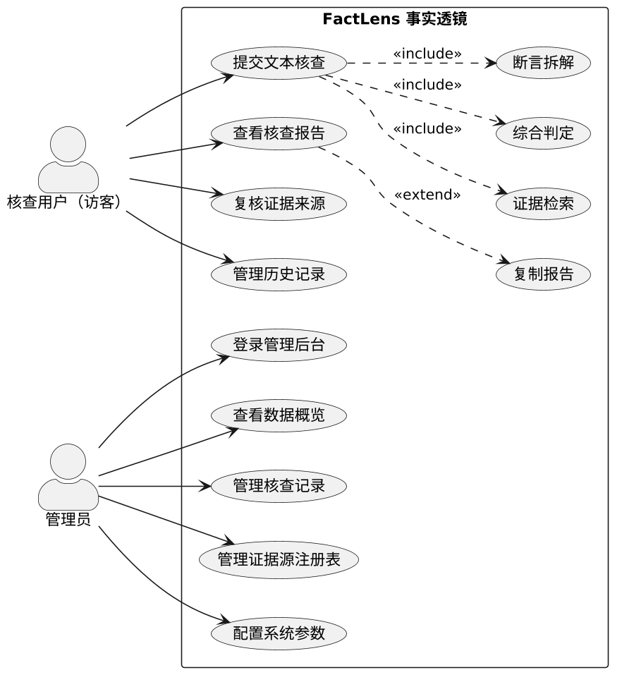
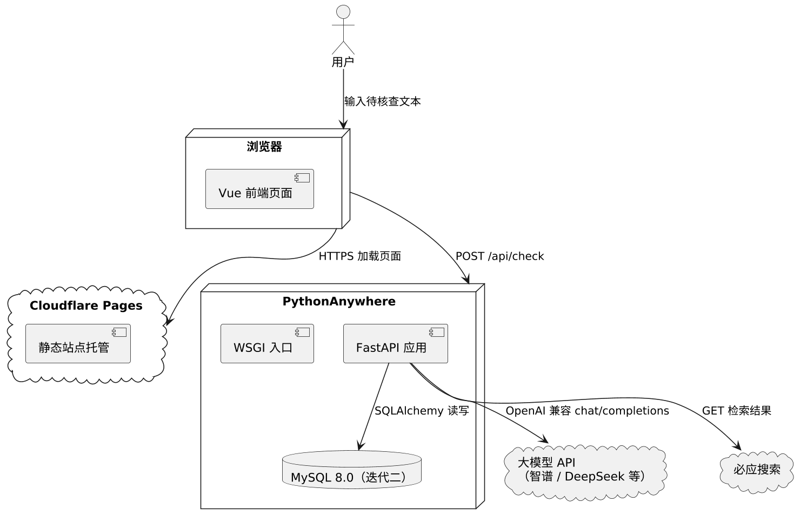
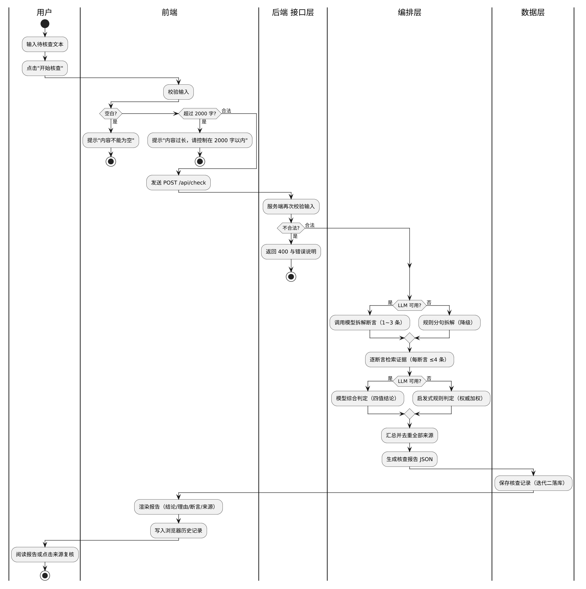
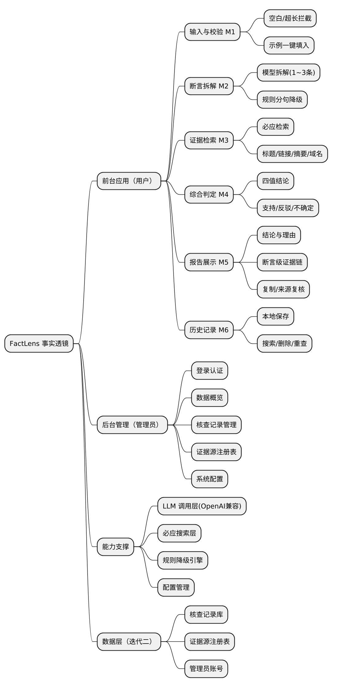
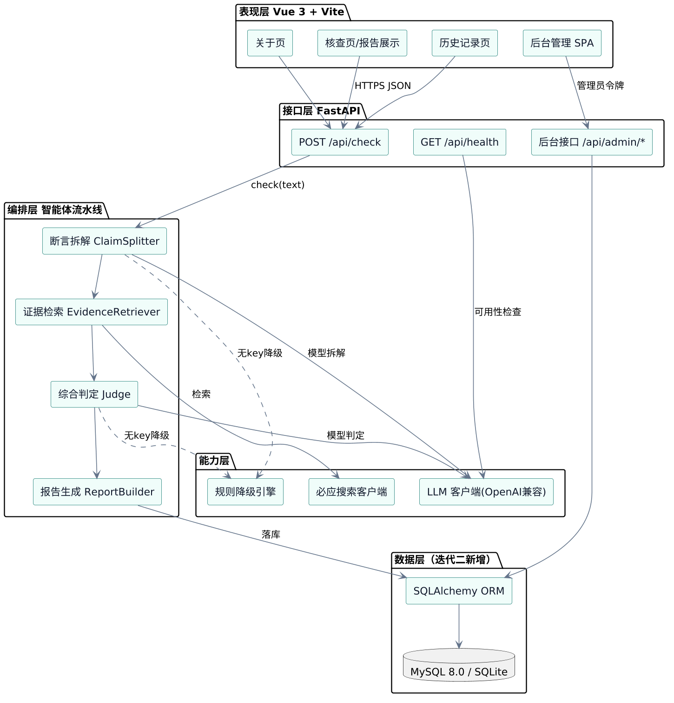
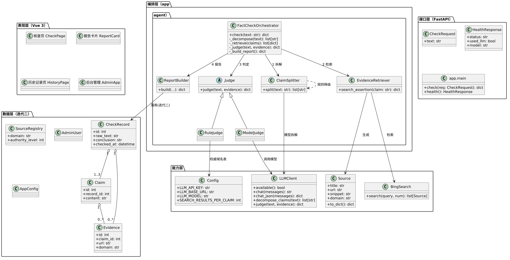
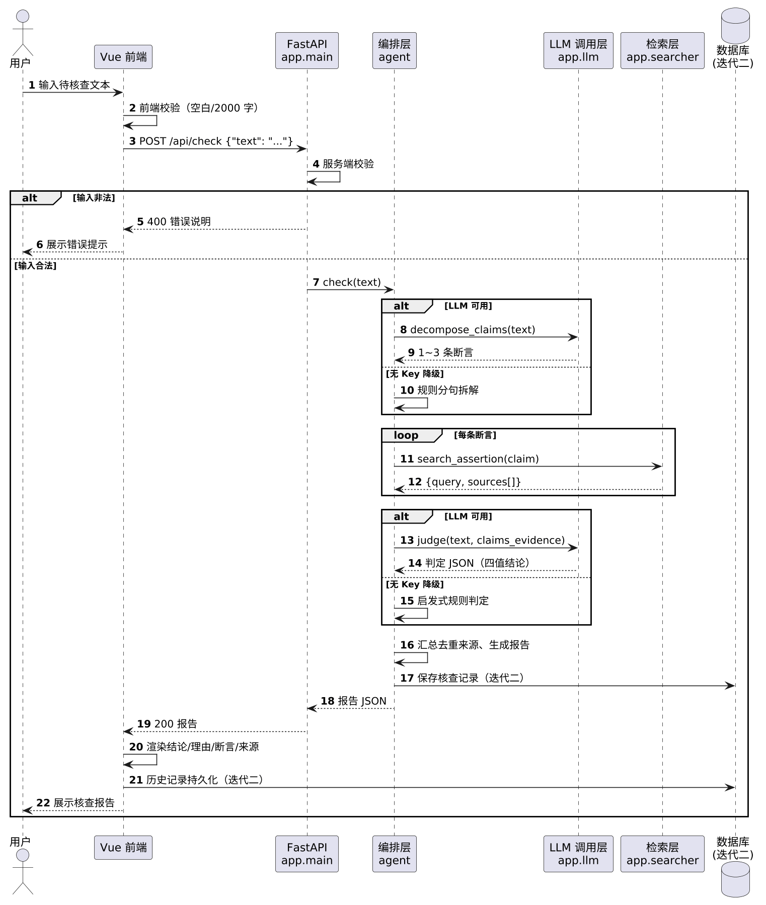
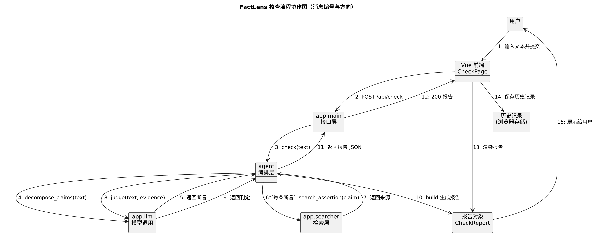

<!-- title: FactLens 事实透镜 -->
<!-- subtitle: AI 多领域虚假信息鉴别智能体 -->
<!-- doctype: 系统设计说明书 -->
<!-- doctype_en: System Design Specification -->
<!-- version: V1.0 -->
<!-- date: 2026-11-22 -->
<!-- team: FactLens -->
<!-- course: 广东工业大学计算机学院 · 计科 24 级 56 班 · 软件工程 -->
<!-- teacher: flowet -->
<!-- members: 3224004156－刘心怡 | 3224004158－杨添媛 | 3224004157－吴纯瑶 | 3224004155－李晨昀 | 3124004111－依木拉木·阿不都苏力 | 3124004121－艾力夏提·艾海买提 | 3124004146－杨宗林 -->

# 1 引言

## 1.1 编写目的

本文档是 FactLens 事实透镜（AI 多领域虚假信息鉴别智能体）的系统设计说明书，对应软件工程课程第二次团队作业（原型设计 + 概要设计）的概要设计部分，依据 GB/T 8567—2006《计算机软件文档编制规范》中概要设计说明书的编制要求编写。

本文档的预期读者与用途如下：

| 读者 | 用途 |
| --- | --- |
| 课程教师与助教 | 评审系统设计的完整性与规范性 |
| 团队全体成员 | 作为迭代二编码、测试与集成的共同依据 |
| 后续维护者 | 了解系统结构、接口约定与出错处理策略 |

本文档从架构的角度自顶向下描述 FactLens 的功能模块划分、运行逻辑、接口设计与数据结构设计：先给出总体结构与处理流程，再逐层细化到模块、接口与数据，为下一阶段的编码实现打下基础。

## 1.2 项目背景

FactLens 是一个中文信息核查网站。用户把一段拿不准真假的文字粘贴进网页，系统经过"断言拆解 → 证据检索 → 结论判定 → 报告输出"的智能体流水线，输出一份可复核的核查报告：报告说明系统如何判断、判断时参考了哪些来源、哪些地方仍需要核实。

项目已按迭代计划完成首版开发并部署上线：前端使用 Vue 3 + Vite 构建，托管于 Cloudflare Pages（factlens-dn7.pages.dev）；后端使用 Python FastAPI 实现，通过 WSGI 部署于 PythonAnywhere（factlens.pythonanywhere.com），对外提供 POST /api/check 与 GET /api/health 两个接口。首版的八项功能（F01～F08）已通过线上验收，验收记录见团队仓库 docs/acceptance.md。

本次作业的设计在首版成果基础上完成以下两件事：

1. **设计定型**：用 UML 与分层架构把首版"跑通"的系统结构显式化、规范化，为迭代二编码提供依据；
2. **演进设计**：规划迭代二新增内容，包括核查记录服务端持久化（首版历史记录仅存浏览器本地）、证据源注册表、管理后台及其鉴权接口。

## 1.3 术语与缩写定义

按编制规范要求，本文档使用的全部缩写与术语在此事先定义：

| 缩写/术语 | 定义 |
| --- | --- |
| AI | Artificial Intelligence，人工智能 |
| LLM | Large Language Model，大语言模型。本系统通过 OpenAI 兼容接口调用，默认使用智谱 GLM-4.7-flash |
| API | Application Programming Interface，应用程序编程接口 |
| JSON | JavaScript Object Notation，本系统前后端与外部服务的通用数据交换格式 |
| REST | Representational State Transfer，本系统接口遵循的 HTTP 风格约定 |
| HTTP(S) | 超文本传输协议（安全版），前端与后端、后端与外部服务的通信协议 |
| CORS | Cross-Origin Resource Sharing，跨域资源共享。后端已配置允许前端跨域调用 |
| WSGI | Web Server Gateway Interface，Python Web 应用部署标准。PythonAnywhere 通过 WSGI 入口挂载 FastAPI 应用 |
| ORM | Object-Relational Mapping，对象关系映射。迭代二数据层采用 SQLAlchemy 实现实体类与库表的映射 |
| SQL | Structured Query Language，结构化查询语言 |
| PK / FK / UK | 主键 / 外键 / 唯一键（数据库约束） |
| CRUD | Create/Read/Update/Delete，增删改查 |
| SPA | Single Page Application，单页应用。前台与后台原型均为单页应用 |
| F01～F08 | 首版八项功能需求编号，见 2.1.1 |
| R01～R05 | 迭代二新增需求编号，见 2.1.2 |
| M1～M7 | 功能模块编号，见 2.4.1 |
| 断言 | 从原文中拆解出的、可独立查证的一项事实陈述 |
| 证据/来源 | 为断言检索到的网页来源，含标题、链接、摘要、域名四个要素 |
| 四值结论 | 系统结论仅取四种之一：确认属实、确认不实、部分属实、暂无法核实 |
| 降级判定 | 未配置 LLM 密钥时，由"搜索 + 启发式规则"完成拆解与判定，结论偏保守 |
| 权威域名 | 官方政府、官方媒体、医疗机构等可信域名（如 gov.cn、people.com.cn），判定时加权 |
| 核查记录 | 一次完整核查的存档：原文、结论、断言、证据与时间 |
| BJT | 北京时间（UTC+8）。系统统一以北京时间标记核查时间 |

## 1.4 参考资料

| 编号 | 资料 |
| --- | --- |
| [1] | 课程作业要求：第二次团队作业（原型设计+概要设计），edu.cnblogs.com/campus/gdgy/Class56-Grade2024-CS/homework/16784 |
| [2] | 第一次团队作业：FactLens 团队展示、选题报告与需求分析（团队博客） |
| [3] | 团队代码仓库：github.com/yyue62353-lab/FactLens（含 docs/requirements.md 需求说明、docs/acceptance.md 验收记录） |
| [4] | GB/T 8567—2006 计算机软件文档编制规范 |
| [5] | GB/T 9385—2008 计算机软件需求规格说明规范 |
| [6] | 线上系统：factlens-dn7.pages.dev（前端）、factlens.pythonanywhere.com（后端） |
| [7] | FastAPI 官方文档、Vue 3 官方文档 |

# 2 总体设计

## 2.1 需求规定

### 2.1.1 首版功能需求（F01～F08）

首版需求已在第一次团队作业中完成分析与验收，本文档仅列出编号与要点，作为设计约束：

| 编号 | 功能 | 要点 |
| --- | --- | --- |
| F01 | 输入 | 输入一段文字并提交；接口拒绝空白与超出 2000 字的输入 |
| F02 | 断言拆解 | 先把原文拆成 1～3 条可分别查证的说法；模型不可用时按句切分 |
| F03 | 证据检索 | 每条断言检索一组来源，保留标题、链接、摘要、域名 |
| F04 | 综合判定 | 输出四值结论之一，并给出理由与不确定因素 |
| F05 | 报告展示与复制 | 查看、复制含摘要、理由、支持、反驳与不确定因素的报告 |
| F06 | 来源复核 | 点击来源标题打开原网页核对上下文；来源按 URL 去重 |
| F07 | 历史记录 | 刷新后仍能查找、删除记录或用原文重新核查（首版存浏览器本地） |
| F08 | 时间与调用状态 | 报告标注北京时间与判定方式（模型/降级） |

### 2.1.2 迭代二新增需求（R01～R05）

针对首版遗留问题与设计文档要求，迭代二规划新增：

| 编号 | 新增需求 | 说明 |
| --- | --- | --- |
| R01 | 核查记录服务端持久化 | 核查报告落库（t_check_record 等六张表），F07 由浏览器本地存储迁移至服务端数据库，历史记录跨设备可见 |
| R02 | 管理后台 | 管理员登录、数据概览、核查记录管理、证据源注册表管理、系统参数配置（见 3.1.2） |
| R03 | 证据源注册表参与判定 | 将权威域名表由代码内硬编码（_AUTHORITY_HINTS）演进为数据库中的 t_source_registry 表，由管理员维护，降级判定与来源排序统一读取该表 |
| R04 | 断言级证据展示完善 | 首版 F06 的摘要尚按全部来源汇总展示，迭代二改为按单条断言分组展示摘要（前端报告卡片已按此设计） |
| R05 | 报告导出 | 在"复制报告"基础上支持导出带来源清单的文本/Markdown 报告 |

### 2.1.3 设计约束

1. 结论取值只能是四值结论之一，任何情况下不得编造证据；
2. 原文长度不超过 2000 字，断言不超过 3 条，每条断言检索结果默认不超过 4 条；
3. 运行环境为免费/低配托管（Cloudflare Pages、PythonAnywhere 免费方案），设计需保持轻量：请求无状态、无长驻后台任务；
4. LLM 密钥只在服务端配置，前端与代码仓库不出现密钥；
5. 所有时间以北京时间（UTC+8）标记。

### 2.1.4 需求用例模型

用例图从需求分析角度给出系统边界与两类参与者（核查用户、管理员）的用例关系：



用例说明：

| 用例 | 参与者 | 说明 |
| --- | --- | --- |
| 提交文本核查 | 核查用户 | 输入文字并提交，触发"断言拆解、证据检索、综合判定"三个包含用例 |
| 查看核查报告 | 核查用户 | 阅读结论、理由、断言与来源；可扩展出"复制报告" |
| 复核证据来源 | 核查用户 | 点击来源链接回到原网页核对 |
| 管理历史记录 | 核查用户 | 搜索、删除历史记录或用原文重新核查 |
| 登录管理后台 | 管理员 | 迭代二新增，鉴权后进入后台 |
| 查看数据概览 / 管理核查记录 / 管理证据源注册表 / 配置系统参数 | 管理员 | 迭代二新增的后台运维用例 |

## 2.2 运行环境

| 层次 | 运行环境 | 说明 |
| --- | --- | --- |
| 客户端 | 现代浏览器（Chrome / Edge / Firefox） | 加载静态前端页面，本地存储历史记录（迭代二迁移服务端） |
| 前端托管 | Cloudflare Pages | 从团队 GitHub 仓库构建 Vue 3 + Vite 产物 |
| 后端运行 | PythonAnywhere（Python 3.12 + WSGI） | FastAPI 应用；模型凭证只在服务端配置 |
| 外部服务 | LLM API（OpenAI 兼容，默认智谱 open.bigmodel.cn）、必应检索（cn.bing.com） | 见 3.2.4、3.2.5 |
| 数据存储 | 迭代二：PythonAnywhere MySQL 8.0；本地开发用 SQLite | 由 SQLAlchemy ORM 屏蔽差异 |

系统部署视图如下：



## 2.3 基本设计概念和处理流程

### 2.3.1 智能体核查流水线

系统的核心是一个四阶段智能体流水线，与首版实现一一对应：

| 阶段 | 职责 | 实现位置（首版） |
| --- | --- | --- |
| 1 断言拆解 | 把原文拆成 1～3 条可独立查证的断言 | llm.decompose_claims / _clean_claims 规则降级 |
| 2 证据检索 | 逐条断言检索网页证据，保留标题、链接、摘要、域名 | searcher.search_assertion（必应） |
| 3 综合判定 | 依据证据给出四值结论、理由、支持/反驳要点、不确定因素 | llm.judge / _judge_no_llm 规则降级 |
| 4 报告输出 | 汇总去重来源，组装核查报告 JSON | agent.check 返回结构 |

### 2.3.2 降级策略

系统设计上保证**服务永远可用**：当 LLM 密钥未配置或调用失败时，自动降级——

- 拆解降级：按句读切分原文，取 1～3 条长度 6～60 字的句子作为断言；
- 判定降级：对来源做"相关性过滤 → 权威域名加权 → 方向词统计"，只采信与断言真正相关的来源，证据不足即输出"暂无法核实"；
- 降级报告的结论偏保守，并明确标注"未配置大模型密钥，采用保守判定"。

### 2.3.3 四值结论定义

| 结论 | conclusion_type | 判定语义 |
| --- | --- | --- |
| 确认属实 | true | 多条相关权威来源方向一致支持，无反驳 |
| 确认不实 | false | 多条相关权威来源方向一致反驳 |
| 部分属实 | partial | 原文多项断言有真有假，或证据方向混杂 |
| 暂无法核实 | unknown | 证据不足或方向不明确，不做强判定 |

### 2.3.4 核查业务流程（活动图）



流程要点（与上图泳道一致）：

1. **用户/前端**：输入文本，前端先行校验空白与 2000 字上限，通过后提交 POST /api/check；
2. **接口层**：服务端独立复校验（不信任前端），非法输入返回 400 与具体说明；
3. **编排层**：LLM 可用则模型拆解断言，否则规则分句；逐断言检索证据；LLM 可用则模型判定，否则启发式规则判定；最后汇总去重来源、生成报告；
4. **数据层**：迭代二将核查记录落库；
5. **前端**：渲染报告并把记录写入历史（迭代二改由服务端持久化）。

## 2.4 系统结构

### 2.4.1 功能模块划分

系统自顶向下划分为七个功能模块：

| 模块 | 名称 | 职责 | 对应需求 | 主要实现位置 |
| --- | --- | --- | --- | --- |
| M1 | 输入与校验 | 文本输入、长度计数、空白/超长拦截、示例填入、防重复提交 | F01 | src/App.vue、app.main |
| M2 | 断言拆解 | 模型拆解或规则分句，输出 1～3 条断言 | F02 | app/llm.py、app/agent.py |
| M3 | 证据检索 | 必应检索、结果解析、来源去重 | F03、F06 | app/searcher.py |
| M4 | 综合判定 | 模型判定或规则降级，输出四值结论与理由 | F04 | app/llm.py、app/agent.py |
| M5 | 报告生成与展示 | 报告组装、前端渲染、复制、断言级证据展示 | F05、R04、R05 | app/agent.py、src/App.vue |
| M6 | 历史记录 | 记录搜索/删除/重新核查（迭代二服务端持久化） | F07、R01 | src/App.vue、数据层 |
| M7 | 管理后台 | 登录、概览、记录管理、证据源注册表、系统配置 | R02、R03 | 后台 SPA、/api/admin/* |

### 2.4.2 功能结构思维导图



### 2.4.3 分层架构

系统采用五层架构，自顶向下依赖，层间通过接口解耦：



| 层 | 职责 | 关键构件 |
| --- | --- | --- |
| 表现层 | 用户交互与结果展示，不包含核查逻辑 | Vue 3 前台（核查页/历史/关于）与后台管理 SPA |
| 接口层 | 参数校验、路由分发、错误码转换 | FastAPI：POST /api/check、GET /api/health、迭代二 /api/admin/* |
| 编排层 | 流水线编排与降级控制 | FactCheckOrchestrator（首版为 agent.check 函数） |
| 能力层 | 可替换的外部能力封装 | LLM 客户端、必应搜索客户端、规则降级引擎、配置 |
| 数据层 | 持久化与实体映射（迭代二新增） | SQLAlchemy ORM、MySQL 8.0 / SQLite |

数据流向（一次核查）：表现层 → 接口层 → 编排层（依次调用能力层的模型/搜索/规则）→ 数据层落库 → 逐层返回报告 JSON → 表现层渲染。

### 2.4.4 类设计（系统结构）

类图描述各层核心类/类型及其关系。其中 CheckRequest、HealthResponse、Source、Config 为首版已有类型；编排层四个构件为首版 agent 模块函数在迭代二的对象化重构；数据层六类为迭代二新增 ORM 实体：



关键设计说明：

1. **判定策略**：Judge 为抽象策略，ModelJudge 调用 LLM 客户端，RuleJudge 依赖 Config 的权威域名表（迭代二改读 t_source_registry）；编排层按"LLM 是否可用"选择策略，与首版 `llm.available()` 分支一一对应；
2. **数据关联**：一次核查记录（CheckRecord）拆解出 1～3 条断言（Claim），每条断言检索到 0～n 条证据（Evidence），证据同时冗余关联记录便于统计；
3. **Source** 是检索结果的值对象，落库时映射为 Evidence。

## 2.5 功能需求与模块的关系

| 需求 | M1 | M2 | M3 | M4 | M5 | M6 | M7 |
| --- | --- | --- | --- | --- | --- | --- | --- |
| F01 输入 | ● | | | | | | |
| F02 断言拆解 | | ● | | | | | |
| F03 证据检索 | | | ● | | | | |
| F04 综合判定 | | | | ● | | | |
| F05 报告展示与复制 | | | | | ● | | |
| F06 来源复核 | | | ● | | ● | | |
| F07 历史记录 | | | | | | ● | |
| F08 时间与调用状态 | | | | | ● | | |
| R01 记录持久化 | | | | | ● | ● | |
| R02 管理后台 | | | | | | | ● |
| R03 证据源注册表 | | | ● | ● | | | ● |
| R04 断言级证据展示 | | | | | ● | | |
| R05 报告导出 | | | | | ● | | |

## 2.6 人工处理过程

本系统仍需少量人工环节，设计中予以明确：

| 人工环节 | 责任人 | 频率 | 内容 |
| --- | --- | --- | --- |
| 证据源注册表维护 | 管理员 | 按需 | 在后台新增/停用域名，维护权威等级与黑名单，供判定加权使用 |
| 核查结论复核 | 用户 | 每次 | 报告仅供辅助判断，重要信息须由用户点击来源自行复核 |
| 模型提示词维护 | 后端组 | 版本迭代时 | 调整拆解/判定提示词，用同一组例句回归对比 |
| 密钥与配置管理 | 后端组 | 按需 | 在服务端 .env 维护 LLM 密钥，不进入代码仓库 |

## 2.7 尚未解决的问题

1. 公网 WSGI 入口文件尚未纳入团队仓库，存在部署文档与代码不一致的风险（迭代二补录）；
2. 必应检索结果与断言的相关性仍靠关键词命中判断，存在不相关来源混入的可能（迭代二引入注册表加权与相关性过滤）；
3. 管理后台鉴权方案（会话/令牌）待迭代二实现时确定；
4. 免费托管平台对长请求与流量的限制，可能影响大规模使用下的稳定性。

# 3 接口设计

## 3.1 用户接口

### 3.1.1 前台页面

| 页面 | 入口 | 主要元素与交互规则 |
| --- | --- | --- |
| 核查页（首页） | #home | 输入框（≤2000 字，实时计数）、三个示例一键填入、开始核查按钮（空输入禁用）；提交后显示四步进度（拆解→检索→判定→报告）；报告卡片含结论徽章、摘要、理由、支持/反驳/不确定三栏、断言级证据、全部来源、复制与重新核查按钮 |
| 历史记录页 | #history | 搜索框按原文关键词过滤；记录卡片含时间、原文截断、结论徽章；支持重新核查（回填原文并自动提交）与删除；一键清空；空状态引导 |
| 关于页 | #about | 项目简介、六项核心功能、核查原则（证据说话/不足即言明/可复核/区分权威/透明告知）、首版局限声明 |

交互规则补充：

1. 结论徽章颜色语义统一：确认属实=绿、确认不实=红、部分属实=琥珀、暂无法核实=灰，前台后台一致；
2. 报告必须标注判定方式：模型判定（蓝色徽章）或降级判定（灰色徽章 + 琥珀色提示条）；
3. 所有异步操作用 toast 轻提示反馈，不做阻断式弹窗；
4. 核查中禁用提交按钮，防止重复请求。

### 3.1.2 后台管理页面（迭代二）

| 页面 | 入口 | 主要元素与交互规则 |
| --- | --- | --- |
| 管理员登录 | /admin | 账号密码登录；鉴权失败提示；演示版提示 |
| 数据概览 | #overview | 四张统计卡（今日核查/累计核查/模型判定占比/平均耗时）、近 7 日核查量折线图、结论分布环形图、最近核查记录表 |
| 核查记录 | #records | 结论类型筛选 + 关键词查询；表格列出时间/原文/结论/断言数/来源数/判定方式；详情抽屉展示完整报告；删除需二次确认 |
| 证据源管理 | #sources | 三类统计卡；注册表表格（域名/类别/权威等级/状态开关/备注）；新增/编辑弹窗表单；等级四档：高/中/低/黑名单 |
| 系统配置 | #config | 模型配置（接口地址/模型名/密钥掩码显示）、检索参数（结果数/超时）、服务状态卡（健康检查、模型可用性、重新检查）、保存配置 |

### 3.1.3 界面规范

原型采用"青绿透镜"设计语言：主色 #0F766E～#14B8A6 渐变，白色卡片 + 1px 灰边框 + 轻投影；字号以 13～15px 为主；所有数据列表支持空状态展示。前台原型与后台原型详见《FactLens 交互原型》（在线预览链接见博客）。

## 3.2 外部接口

### 3.2.1 POST /api/check —— 提交文本核查

请求（JSON）：

```json
{ "text": "地球是太阳系的一颗行星。" }
```

成功响应（JSON，字段含义见表）：

```json
{
  "conclusion": "确认属实",
  "conclusion_type": "true",
  "summary": "原文只有一项核心断言……",
  "reason": "断言唯一且边界清晰……",
  "support": ["维基百科：地球是太阳系中……"],
  "against": [],
  "uncertainties": ["不同来源对行星分类的历史表述存在差异……"],
  "claims": [
    { "claim": "地球是太阳系的一颗行星。",
      "sources": [ { "title": "地球 - 维基百科", "url": "https://zh.wikipedia.org/wiki/地球", "snippet": "地球是太阳系中由内及外的第三颗行星……", "domain": "zh.wikipedia.org" } ] }
  ],
  "sources": [ { "title": "地球 - 维基百科", "url": "…", "snippet": "…", "domain": "zh.wikipedia.org" } ],
  "checked_at": "2026-11-21 20:14",
  "used_llm": true
}
```

| 字段 | 类型 | 说明 |
| --- | --- | --- |
| conclusion | string | 四值结论中文名 |
| conclusion_type | string | true / false / partial / unknown，供前端映射颜色 |
| summary | string | 整体分析摘要 |
| reason | string | 判定理由（依据了哪些证据） |
| support / against / uncertainties | string[] | 支持/反驳要点、不确定因素 |
| claims | array | 断言及其各自来源（claims[].sources） |
| sources | array | 全部来源，已按 URL 去重 |
| checked_at | string | 核查时间（北京时间） |
| used_llm | boolean | 是否模型判定 |

错误响应：空白输入与超长输入返回 HTTP 400（"待核查内容不能为空" / "内容过长，请控制在 2000 字以内"）；核查过程异常返回 HTTP 500（"核查过程出错：…"）。

### 3.2.2 GET /api/health —— 健康检查

返回服务状态与配置的模型名称，不执行真实核查：

```json
{ "status": "ok", "used_llm": true, "model": "glm-4.7-flash" }
```

### 3.2.3 迭代二后台接口规划（/api/admin/*）

| 接口 | 方法 | 用途 | 鉴权 |
| --- | --- | --- | --- |
| /api/admin/login | POST | 管理员登录，换取令牌 | 公开 |
| /api/admin/overview | GET | 概览统计（总量/趋势/结论分布） | 管理员令牌 |
| /api/admin/records | GET | 分页查询核查记录（结论、关键词筛选） | 管理员令牌 |
| /api/admin/records/{id} | GET / DELETE | 记录详情 / 删除 | 管理员令牌 |
| /api/admin/source-registry | GET / POST / PUT / DELETE | 证据源注册表 CRUD | 管理员令牌 |
| /api/admin/config | GET / PUT | 读取/保存系统参数 | 管理员令牌 |

### 3.2.4 LLM 外部接口（OpenAI 兼容）

- 调用方式：HTTP POST `{LLM_BASE_URL}/chat/completions`，Bearer 密钥鉴权；
- 请求体：model（默认 glm-4.7-flash）、messages、temperature（拆解 0.1 / 判定 0.2）、max_tokens（1200～2000）；
- 拆解与判定均要求模型只输出 JSON，由 _chat_json 清洗围栏并解析；
- 超时 60 秒；HTTP 非 200 或解析失败时抛异常，由编排层捕获后整体降级；
- 密钥未配置时 llm.available() 为 false，接口层与前端不感知，直接进入降级路径。

### 3.2.5 必应检索接口

- 调用方式：HTTP GET cn.bing.com/search?q=<断言>，携带桌面浏览器 User-Agent 与中文语言头；
- 解析规则：按 `li.b_algo` 结果块提取标题、跳转链接（还原真实 URL）、摘要；
- 超时 20 秒，失败返回空来源列表（不中断核查）；
- 每条断言默认取前 4 条（SEARCH_RESULTS_PER_CLAIM 可配置）。

## 3.3 内部接口

| 接口（函数） | 所在模块 | 输入 → 输出 | 说明 |
| --- | --- | --- | --- |
| check(text) | app.agent | text → 报告 dict | 流水线编排入口，唯一被接口层调用 |
| _clean_claims(text) | app.agent | text → list[str] | 规则分句降级 |
| _judge_no_llm(text, evidence) | app.agent | → 判定 dict | 启发式降级判定 |
| _dedup_sources(sources) | app.agent | → list[dict] | 按 URL 去重 |
| available() | app.llm | → bool | 密钥是否配置 |
| _chat / _chat_json(messages) | app.llm | → str / dict | 原始调用与 JSON 调用 |
| decompose_claims(text) | app.llm | → list[str] 或 None | 模型拆解，不可用返回 None |
| judge(text, claims_evidence) | app.llm | → dict 或 None | 模型判定，不可用返回 None |
| search(query, num) | app.searcher | → list[Source] | 必应检索 |
| search_assertion(assertion) | app.searcher | → {query, sources} | 单断言检索 |
| 数据层仓库接口（迭代二） | 数据层 | CRUD | CheckRecordRepository、SourceRegistryRepository 等，供编排层与后台调用 |

约定：能力层函数失败时不向调用方抛不可控异常——检索失败返回空列表，模型失败返回 None，由编排层统一降级处理。

# 4 运行设计

## 4.1 运行模块组合

| 运行模块 | 运行形态 | 组合说明 |
| --- | --- | --- |
| 前端静态站点 | Cloudflare Pages 静态资源 | 浏览器加载后以 SPA 运行，通过 HTTPS 调用后端 |
| 后端服务 | PythonAnywhere WSGI 单进程 | FastAPI 应用 + 数据库连接池；无长驻后台任务，请求即来即处理 |
| 外部服务 | 公网 HTTP 调用 | LLM API 与必应检索均按需调用，均有超时与失败兜底 |

## 4.2 运行控制

一次核查请求的控制流与时序如下（时序图描述重要的算法模块——智能体核查流水线）：



对象间消息传递与协作关系如下（协作图，消息编号与时序图一致）：



运行控制要点：

1. 前端防抖：核查进行中禁用提交，避免重复请求；
2. 降级控制：编排层在拆解与判定两个决策点检查 llm.available()，形成"模型路径/规则路径"双轨；
3. 兜底控制：接口层捕获一切未处理异常并转换为 HTTP 500 说明，前端永不看到崩溃页；
4. 状态可观测：每次报告携带 used_llm 与 checked_at，请求可经 request_id（迭代二）关联服务端日志。

## 4.3 运行时间

| 阶段 | 预期耗时 | 超时/上限 |
| --- | --- | --- |
| 输入校验 | < 1 ms | — |
| 断言拆解（模型） | 3～8 s | 60 s |
| 证据检索（每条断言） | 1～5 s | 20 s |
| 综合判定（模型） | 5～12 s | 60 s |
| 报告组装与落库 | < 1 s | — |
| 端到端（模型模式） | 目标 ≤ 15 s | 视托管平台限制 |
| 端到端（降级模式） | 目标 ≤ 25 s | 视托管平台限制 |

性能设计：请求无状态、可水平扩展；迭代二将逐断言检索改为并发执行；前端保持单请求单报告，减少冗余调用。

# 5 系统数据结构设计

## 5.1 逻辑结构设计要点

核心数据对象及其逻辑关系：

| 对象 | 关键属性 | 关系 |
| --- | --- | --- |
| 核查记录 CheckRecord | 原文、结论、摘要、理由、支持/反驳/不确定（JSON）、时间、判定方式 | 1 条记录拆出 1～3 条断言 |
| 断言 Claim | 内容、序号 | 1 条断言对应 0～n 条证据 |
| 证据 Evidence | 标题、URL、摘要、域名、权威等级 | 由来源值对象 Source 落库而来 |
| 证据源注册表 SourceRegistry | 域名、类别、权威等级、状态、备注 | 与证据按域名匹配（非强制关联） |
| 管理员 AdminUser | 账号、口令哈希、角色、状态 | 维护注册表与配置 |
| 系统配置 AppConfig | 键、值、说明 | 键值对，覆盖 Config 默认值 |

首版历史记录存于浏览器 localStorage（键 factlens_history_v1，数组元素含原文、结论、时间）；迭代二迁移至 t_check_record，localStorage 仅作离线缓存。

## 5.2 物理结构设计要点

1. 数据库：线上 MySQL 8.0（PythonAnywhere 提供），本地开发 SQLite，由 SQLAlchemy ORM 屏蔽差异；
2. 字符集 utf8mb4，排序规则 utf8mb4_unicode_ci，存储引擎 InnoDB；
3. 主键均为 BIGINT 自增；证据 URL 建立 url_hash 唯一索引防重；记录表建 (checked_at) 与 (conclusion_type) 索引支撑后台统计；断言/证据按外键建索引；
4. 报告中的支持/反驳/不确定要点以 JSON 列存储，避免过度拆表；原文 TEXT、摘要 VARCHAR(500)；
5. 详细设计见《FactLens 数据库设计说明书》。

## 5.3 数据结构与程序的关系

各模块对数据结构的访问关系：

| 模块 | 访问的数据结构 |
| --- | --- |
| M2/M3/M4 编排层 | 内存对象：断言列表、来源列表、判定 dict（不直接碰库） |
| M5 报告生成 | 组装报告 dict；迭代二经 ReportBuilder 落库 t_check_record/t_claim/t_evidence |
| M6 历史记录 | 迭代二读 t_check_record（前端 localStorage 为缓存） |
| M7 管理后台 | t_admin_user、t_check_record、t_source_registry、t_app_config |
| 判定降级（RuleJudge） | 读 t_source_registry 权威域名（迭代二） |

类图见 2.4.4，实体与库表的对象关系映射详见《FactLens 数据库设计说明书》附录 A。

# 6 系统出错处理设计

## 6.1 出错信息

| 场景 | 表现 | 用户看到的信息 |
| --- | --- | --- |
| 空白输入 | 前端拦截 / 后端 400 | "待核查内容不能为空" |
| 超过 2000 字 | 前端计数变红 / 后端 400 | "内容过长，请控制在 2000 字以内" |
| LLM 密钥未配置 | 自动降级 | 报告标注"降级判定"，琥珀色提示条 |
| LLM 调用超时/失败 | 编排层捕获，走降级 | 同上；健康检查接口可查看 used_llm |
| 检索超时/失败 | 返回空来源 | 报告"暂无来源"，结论多为"暂无法核实" |
| 后端未处理异常 | 接口层兜底 | HTTP 500："核查过程出错：…" |
| 网络不通 | 前端请求失败 | toast 提示"网络异常，请稍后重试" |

## 6.2 补救措施

1. **双轨降级**：任何模型环节失败都自动切换到规则路径，保证核查流程完整跑通；
2. **失败隔离**：检索失败不中断核查；单条断言无结果时继续其余断言；
3. **幂等与重试**：前端防重复提交；用户可点击"重新核查"再次提交；
4. **可观测**：used_llm 字段 + 健康检查接口，运维可快速判断是否配置异常。

## 6.3 系统维护设计

1. **配置维护**：服务端 .env（LLM_API_KEY、LLM_BASE_URL、LLM_MODEL、SEARCH_RESULTS_PER_CLAIM），修改后重启 WSGI 生效；迭代二改由后台"系统配置"页维护；
2. **日志维护**：后端记录请求日志，迭代二引入 request_id 串联一次核查的全部调用；
3. **数据维护**：MySQL 每日自动备份（PythonAnywhere 托管能力），t_check_record 按月归档；
4. **发布维护**：前端由 Cloudflare Pages 监听仓库自动构建；后端以仓库为唯一代码源，WSGI 入口文件补录仓库后统一维护。

# 附录 A 设计图汇总

| 图 | 章节 | 文件 |
| --- | --- | --- |
| 用例图 | 2.1.4 | assets/usecase.png |
| 部署图 | 2.2 | assets/deployment.png |
| 活动图 | 2.3.4 | assets/activity.png |
| 功能模块思维导图 | 2.4.2 | assets/mindmap.png |
| 分层架构图 | 2.4.3 | assets/architecture.png |
| 类图 | 2.4.4 | assets/class.png |
| 时序图 | 4.2 | assets/sequence.png |
| 协作图 | 4.2 | assets/collaboration.png |
| ER 图与数据库设计 | 另册 | 见《FactLens 数据库设计说明书》 |
